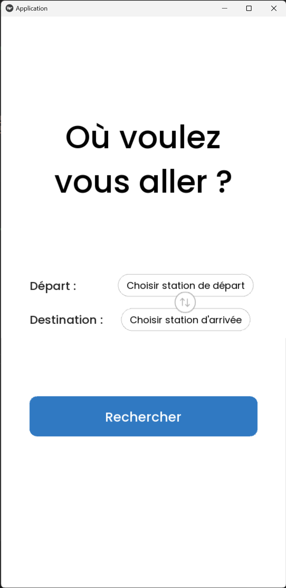
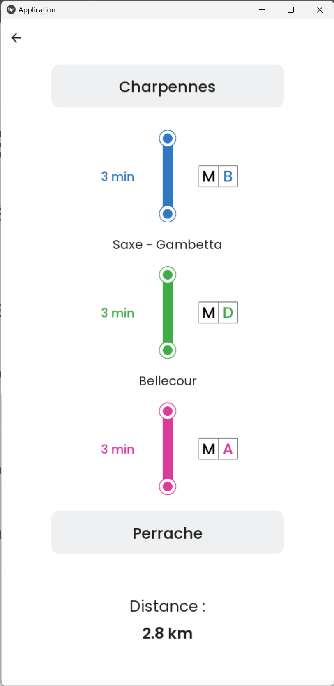

# Lyon Metro Route Planner

A route planner for the Lyon metro and funicular network (TCL), built in Python with a mobile-style
interface in KivyMD. It downloads the network from the **Grand Lyon open data API**, models it as a
**graph** and finds the shortest route between two stations with **Dijkstra's algorithm**, then shows
the line changes, the time on each line and the total distance.

It was our **TIPE** (a research project in the French *classes préparatoires*, PT, January–April 2023),
built in a pair by **Gabin Mondongou** and **Damien Reynier** ([@Dazeria](https://github.com/Dazeria)).

> School project from 2023, published for reference. The code, its comments and the
> [project report](docs/Compte-rendu-TIPE.pdf) (*Métroptimisation*, 29 pages) are in French.

<p>
  
  
</p>

## How it works

1. **Open data** (`Recuperation_donnees.py`) — downloads the metro/funicular lines and all public transport
   stops from the Grand Lyon WFS API (GeoJSON, `requests`), keeps only metro and funicular stations, merges
   duplicates and orders the stations of each line by walking from the terminus to the nearest next station.
2. **Graph model** (`Matrice_adjacence.py`) — builds a weighted **adjacency matrix** (NumPy): two stations
   are connected when they are consecutive on a line, weighted by their distance.
3. **Shortest path** (`Algo_PCC.py`) — Dijkstra's algorithm in two versions (adjacency matrix, and adjacency
   dictionary with a `heapq` priority queue), plus an **A\*** variant using the straight-line distance as heuristic.
   `Tests.py` benchmarks the three on the same trip.
4. **Line changes** (`Changements.py`) — walks along the path to find where the traveller changes lines.
5. **Graph analysis** (`Verifications.py`) — connectivity (depth-first search), density, Dirac's condition
   for a Hamiltonian cycle, and the most central stations.
6. **App** (`Main.py`, `page_principale.kv`, `page_resultats.kv`) — KivyMD interface: station drop-downs,
   swap button, and a results screen with each line's colour and icon, the time per line (from a mean metro
   speed) and the total distance in km.

## Results

All three algorithms returned the same routes in every test. Mean time per search over 10,000 runs, on the
longest trip of the network (Gare de Vaise → Vaulx-en-Velin La Soie):

| Algorithm | Data structure | Time per search |
| --- | --- | --- |
| Dijkstra | adjacency matrix | 2.5 ms |
| A\* | adjacency matrix | 1.05 ms |
| Dijkstra | adjacency dictionary + `heapq` | **0.062 ms** |

With the same data structure, A\* was about twice as fast as Dijkstra; but switching Dijkstra from a matrix
to a dictionary with a priority queue made it 40 times faster. Our conclusion: **how the graph is stored mattered
as much as, or more than, the choice of algorithm.** The [report](docs/Compte-rendu-TIPE.pdf) details the
graph analysis (connected, not Hamiltonian, not regular), the tests and the interface.

## Who did what

- **Gabin** — open data retrieval, adjacency matrix, line-change detection, the KivyMD app and its interface.
- **Damien** — the shortest-path algorithms (Dijkstra, A\*), the graph analysis and the benchmark.

## Run it

```bash
pip install -r requirements.txt
python Main.py
```

The app uses KivyMD 1.x (`kivymd<2`): version 2.0 changed the list and menu widgets it relies on.

## Known limitations

- **The open data format has changed since 2023**, so the app no longer starts as is: line codes are now
  single letters and the stops layer has grown to more than 9,700 features, beyond the `count=4657` in the
  request. `recup()` would need to be updated to the new format.
- In `distance()`, the second station's `y` coordinate is read from the first station, so distances only use
  the `x` difference. This most likely explains the manual fix for the *Cuire* station in `recup()` and the
  calibration factor (Foch–Masséna distance) used to convert distances to metres in `Main.py`.
- The network is downloaded again at every launch; there is no local cache.

## Credits

- Gabin Mondongou and Damien Reynier — PT, 2023 (code and report).
- Network data: [Grand Lyon open data](https://data.grandlyon.com/) (TCL / SYTRAL).
- Font: [Poppins](https://fonts.google.com/specimen/Poppins), under the SIL Open Font License (`Poppins/OFL.txt`).
